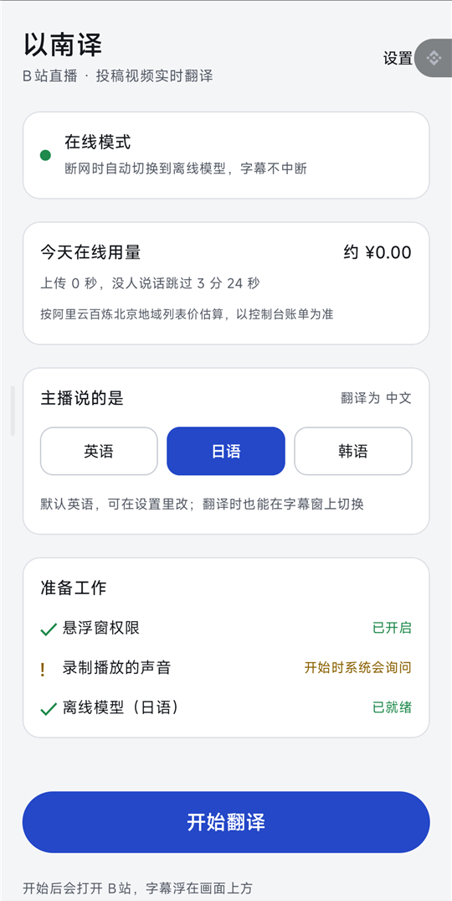
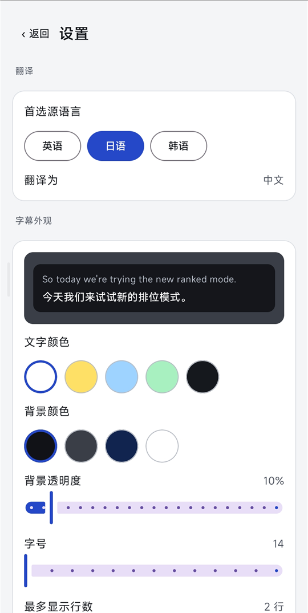
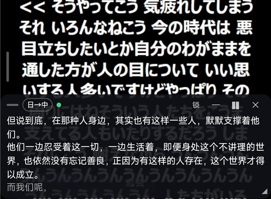
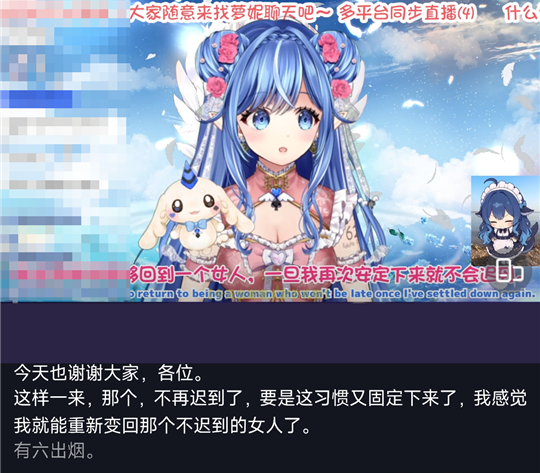

# 以南译


看 B站 外语直播和投稿视频时，把**英语、日语、韩语**实时翻成**中文字幕**，以悬浮窗的形式显示在画面上。

- 默认用在线同传，译文自然、懂上下文；断网或出错时自动切到手机本地的离线模型，字幕不中断，切换时字幕窗会提示
- 默认翻译 B站，也可以在设置里换成 YouTube、Twitch 或手机上任何能出声的 App；默认录手机播放的声音，也可以只录来源 App 的声音，别的 App 的声音就不会混进来
- 字幕窗可拖动、调宽度、收起，可以锁定成「点击穿透」，不挡 B站 的按钮
- 第一次打开有新手引导；下拉通知栏的快捷开关一点就开始翻译
- 每日在线用量可设上限，超了自动切离线；翻译内容可事后回看、复制、分享

## 界面

| 首页 | 设置 |
| :---: | :---: |
|  |  |

| 悬浮字幕（日语直播 → 中文） | 控制条自动隐藏后 |
| :---: | :---: |
|  |  |

| 横屏全屏 | 收起后（右侧「译」小圆点） |
| :---: | :---: |
|  |  |

> 截图里的直播画面来自 B站，左侧弹幕栏已打码，透过字幕窗的弹幕用户名已抹去。

## 功能

**悬浮字幕窗**

- 竖屏默认贴在视频下方，横屏在底部居中；横竖屏各自记住位置和宽度
- 高度随字幕行数自动变化，不留空白
- 控制条 3 秒无操作自动隐藏，点字幕再出来
- 手势：双指在字幕上捏合调字号（12–32）；双击字幕暂停 / 继续；拖动后靠近屏幕左右边自动吸附，靠近正中自动居中
- 字幕停留时间可设（不限 / 3 / 5 / 8 / 15 秒）：说完话字幕自动淡出，窗口也不再挡住 B站 的点击
- 控制条按钮（线条图标收在一个胶囊里）：锁定（点击穿透到 B站）、收起成小圆点、暂停、关闭；左侧点语言标签切换源语言
- 字幕外观可调：文字颜色、背景颜色、背景透明度、字号、最多显示行数、是否显示原文、文字描边；
  也可以一键套用预设（默认 / 电影 / 明亮 / 大字）
- 状态提示：断网、在线出错、恢复在线、用量接近或达到上限时，字幕上方会弹出一条几秒后消失的提示

**翻译**

| | 在线（默认） | 离线 |
| --- | --- | --- |
| 服务 / 模型 | 阿里云百炼 千问 LiveTranslate | 识别：ReazonSpeech（日语）、SenseVoice（英语、韩语）<br>翻译：腾讯 HY-MT1.5-1.8B |
| 什么时候用 | 有网络并填了 API Key | 断网、在线出错、没填 Key，或设置里选了「始终离线」 |
| 特点 | 边说边出，按句断开显示 | 全部在手机上运行，不花钱 |

- **术语表**：给主播名、游戏名、常见梗指定固定译法，在线和离线都生效；支持批量导入（每行 `原文=译文`）和复制全部
- **省钱**：在线模式下没人说话时不上传音频；可选「只录来源 App 的声音」；首页显示当天上传时长和估算费用，
  设置里可以选每日上限（默认 ¥10，可选不限制），超过后自动切离线，第二天或调高上限后自动回到在线
- **稳定**：在线断线先自动重连，连不上再切离线，网络恢复后切回在线

**翻译记录**：每次翻译的字幕会自动保存在手机上（最多最近 30 次），首页「翻译记录」里可以回看、长按复制，
或把整场导出成文本分享出去。设置里可以关闭保存或一键清空。

**来源 App**：设置 →「翻译与识别」→「来源 App」里可以把要翻译的 App 从默认的 B站 换成 YouTube、Twitch、抖音，或手机上任何能打开的 App
（列表可搜索）。「开始翻译」后会自动打开它，也可以关掉自动打开、自己切过去。录音是系统级的，只要那个 App 允许被录音，字幕就能出来。

**无声自动停止**：连续一段时间（默认 30 分钟，可选 5 / 10 / 30 / 60 分钟或不停止）没有声音，就自动停止翻译，
并在通知栏留一条「已自动停止」；停止前 1 分钟字幕窗会先提示。直播看完忘了关也不会一直挂着。

**快捷开关**：设置 →「翻译与识别」→「快速开关」里把「以南译」加到下拉通知栏，之后一点就开始，翻译中再点一下停止。
开始时仍要在系统弹窗里允许一次录屏，这是 Android 的要求。

## 安装和使用

1. 从 [Releases](https://github.com/847415859/simultaneous_interpretation/releases) 下载最新的 `yinanyi-x.y.z.apk`，在手机上安装（Android 10 及以上）。
2. 第一次打开会进入四步新手引导（之后可在设置 →「关于」里重新查看），每一步都能跳过，首页「准备工作」里随时补：
   1. **悬浮窗权限**：字幕要盖在 B站 上面。
   2. **在线翻译 Key**（可选）：点「去获取 Key」打开[阿里云百炼](https://bailian.console.aliyun.com/)的 API-KEY 页面（北京地域），创建并复制，
      回到 App 会自动识别剪贴板里的 `sk-…`，点「使用并测试」即可；也可以点「粘贴 Key」或手动输入。
      保存后会自动测试能不能用（只握手，不产生费用），并区分 Key 无效、账号没开通、网络问题。
      Key 只保存在手机上，安装包里不含任何密钥。不填则只用离线翻译。
   3. **离线模型**（可选）：选主播常用的语言，一键下载，见下文「离线模型」。
   4. **后台运行**：允许后台不被系统杀掉。小米手机还要把省电策略设为「无限制」、打开自启动，否则看直播时翻译可能被系统关掉。
3. 选好主播说的语言，点「开始翻译」。填了 Key 的话，第一次会先问你是否同意把声音上传到阿里云（见下文「隐私」）。
   然后允许录音和录屏，App 会自动打开 B站。

## 隐私

- **在线翻译**会把 B站 播放的声音实时上传到阿里云百炼（中国大陆服务器）翻译，用的是你自己的 API Key，费用由你的账号承担。
  没人说话时不上传；阿里云如何处理数据，以它的服务条款为准。第一次使用前 App 会让你确认。
- **想让声音不出手机**：设置 →「翻译与识别」里选「始终使用离线模式」，全部识别和翻译都在本机完成。
- 默认录手机上播放的声音；设置 →「翻译与识别」→「来源 App」里可以开启「只录它的声音」，避免别的 App 的声音被识别、上传。
- API Key、翻译记录、术语表、用量统计都只存在这台手机上，不会上传到作者或其他服务器。

## 构建

需要 Android Studio，或 JDK 21 + Android SDK（含 NDK 28.2.13676358、CMake 3.22.1）。
下面两样太大，没有放进仓库，构建前自己下载：

1. **llama.cpp 源码**：[b11181](https://github.com/ggml-org/llama.cpp/releases/tag/b11181)，解压到 `third_party/llama.cpp-b11181/`
2. **sherpa-onnx**：[sherpa-onnx-1.13.8.aar](https://github.com/k2-fsa/sherpa-onnx/releases/tag/v1.13.8)，放到 `yinanyi/app/libs/`

然后在 `yinanyi/` 下运行 `gradlew assembleDebug`，安装包在 `yinanyi/app/build/outputs/apk/debug/`。
单元测试：`gradlew testDebugUnitTest`（下载器的续传、换源、校验，API Key 识别，术语表导入解析都有测试）。

## 发布

`gradlew assembleRelease` 生成压缩混淆后的安装包。没有签名密钥时用 debug 签名，只能自己试用；
正式发布要用固定的发布签名，否则换一台电脑编译出来的包无法覆盖安装。

1. 生成密钥库（**放在仓库之外，并且备份**；丢了就没法再发布能覆盖安装的更新）：
   ```
   keytool -genkeypair -keystore yinanyi-release.jks -alias yinanyi -keyalg RSA -keysize 4096 -validity 36500
   ```
2. 在 `yinanyi/` 下新建 `keystore.properties`（已被 `.gitignore` 忽略，不要提交）：
   ```
   storeFile=D\:\\path\\to\\yinanyi-release.jks
   storePassword=……
   keyAlias=yinanyi
   keyPassword=……
   ```
3. 在线翻译的 API Key 不在安装包里，所以发布的 APK 可以公开。

## 离线模型

模型共约 1.4 GB，不在安装包里，在 App 里按语言一键下载（日语约 73 MB，英韩约 237 MB，翻译模型约 1.1 GB）。
每个文件下载后都会按固定的 SHA-256 校验，内容不对会丢弃并换下一个下载源，支持断点续传，所以下载源可以是任何镜像。

| 模型 | 用途 | 下载源 |
| --- | --- | --- |
| 翻译 HY-MT1.5-1.8B（Q4_K_M，1.1 GB） | 所有语言的离线翻译 | ModelScope，腾讯官方账号 [Tencent-Hunyuan](https://modelscope.cn/models/Tencent-Hunyuan/HY-MT1.5-1.8B-GGUF)；备用 Hugging Face 镜像 |
| SenseVoice（237 MB） | 英语、韩语识别 | ModelScope（第三方上传，内容与官方一致，已按 SHA-256 核对） |
| ReazonSpeech `zipformer-ja-en`（int8，73 MB） | 日语识别 | 本项目自己的 ModelScope 仓库。官方文件只发布在 GitHub 上、国内很多网络连不上，所以从官方压缩包里挑出 4 个 int8 文件原样转存了一份（SHA-256 在仓库的 README 里） |
| Silero VAD（0.6 MB） | 断句 | 已内置在 App 里 |

**手动安装**（开发调试用）：也可以把文件放到手机上 App 的目录 `/sdcard/Android/data/com.yinanyi.app/files/models/`（用 `adb push`），App 会按文件名和大小自动识别：

| 文件 / 目录 | 用途 |
| --- | --- |
| `reazon-ja/`（`encoder-epoch-35-avg-1.int8.onnx`、`decoder-epoch-35-avg-1.int8.onnx`、`joiner-epoch-35-avg-1.int8.onnx`、`tokens.txt`） | 日语识别 |
| `sense-voice/`（`model.int8.onnx`、`tokens.txt`） | 英语、韩语识别 |
| `HY-MT1.5-1.8B-Q4_K_M.gguf` | 翻译 |

文件大小必须和官方文件一致，否则 App 会认为没装好。

## 许可与声明

以南译是个人开发的非官方工具，与腾讯、阿里云、哔哩哔哩无关。第三方组件和模型的许可见 [NOTICE.md](NOTICE.md)。
其中翻译模型（腾讯混元 HY-MT1.5）的许可**不适用于欧盟、英国和韩国**。

## 目录

| 目录 | 说明 |
| --- | --- |
| `yinanyi/` | App 源码（包名 `com.yinanyi.app`） |
| `yinanyi/design/icons/` | 图标源文件和渲染脚本 |
| `NOTICE.md` | 第三方组件与许可声明 |
| `docs/screenshots/` | README 里的界面截图和处理脚本 |
